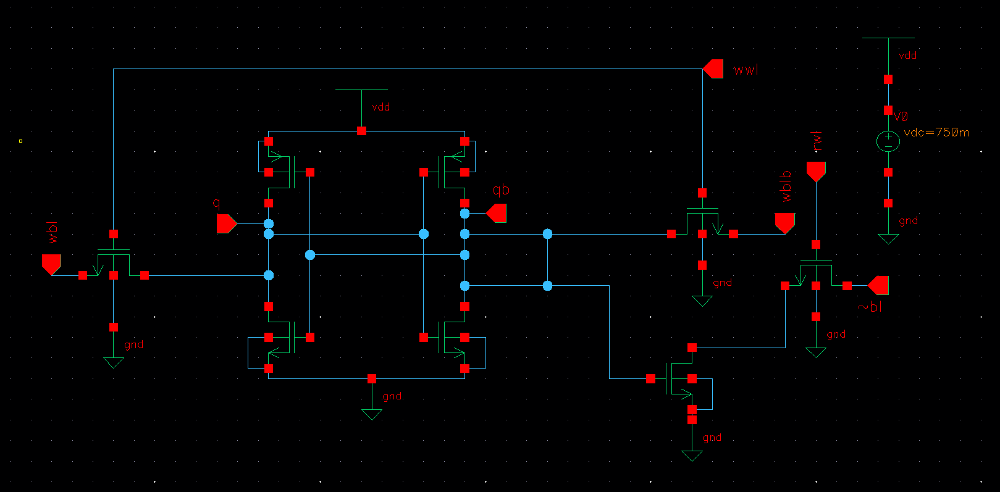
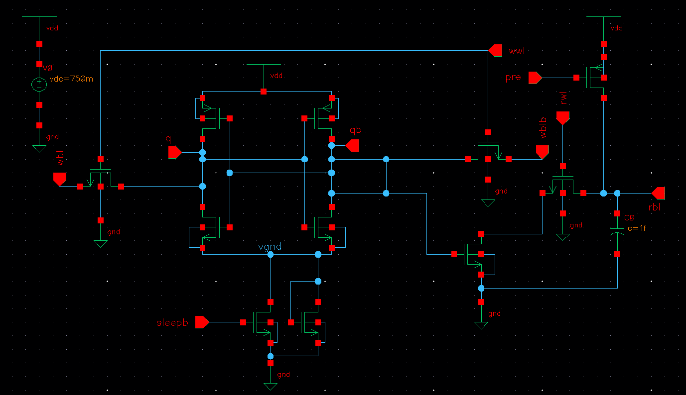
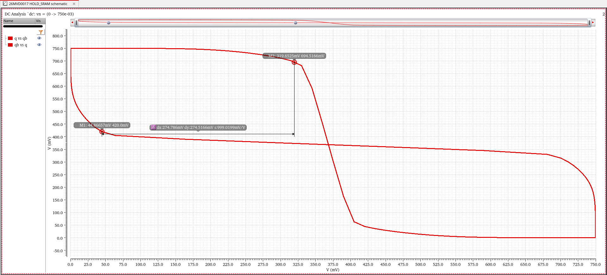
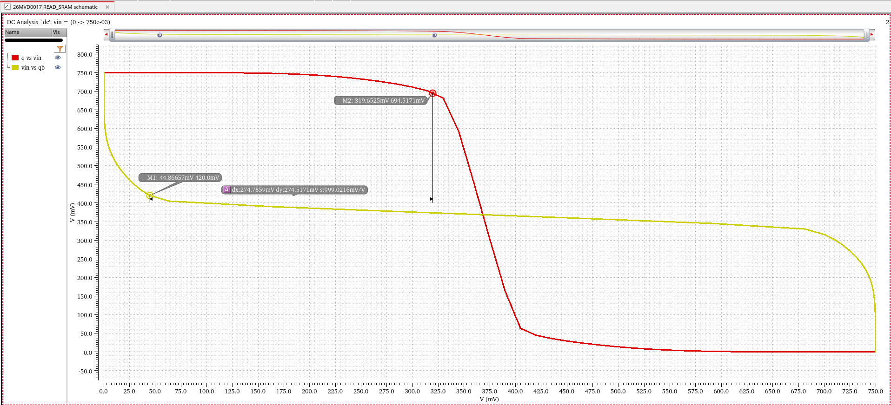
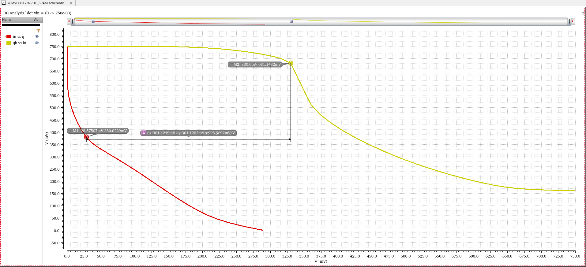
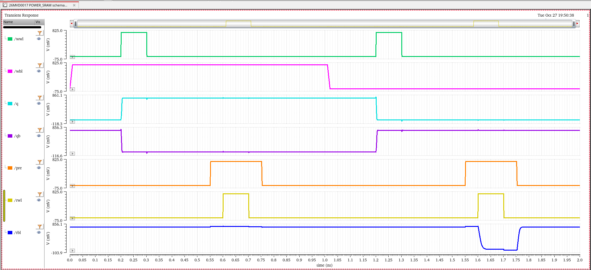

# Read-Decoupled 8T SRAM in 10-nm FinFET

Stability and power analysis of a read-decoupled 8T SRAM cell in 10-nm FinFET technology, with power optimization using a diode-clamped gated-ground footer.

Designed and simulated in Cadence Virtuoso (Spectre) using the 10-nm PTM-MG high-performance FinFET models at VDD = 0.75 V and 27 °C.

**Paper:** [`paper/sram8t_paper.pdf`](paper/sram8t_paper.pdf) (4-page IEEE conference format)

## Results

| Metric | Value | % of VDD |
|---|---|---|
| Hold SNM (HSNM) | 274.5 mV | 36.6 % |
| Read SNM (RSNM) | 274.5 mV | 36.6 % |
| Write SNM (WSNM) | 301.1 mV | 40.1 % |
| RSNM / HSNM | 1.00 | — |
| Average power, conventional 8T | 468.10 nW | — |
| Average power, with gated-ground footer | 441.85 nW | — |
| Power reduction | 26.26 nW (5.6 %) | — |

The read SNM equals the hold SNM because the read port connects to the storage node only through a transistor gate, so a read never disturbs the stored data. A conventional 6T cell typically keeps only about half of its hold margin during a read.

## The cell



- **Storage core:** two cross-coupled inverters (Q, QB).
- **Write port:** two NMOS access transistors on WWL, with differential write bitlines WBL and WBLB.
- **Read port:** two series NMOS transistors (read driver gated by QB, access transistor gated by RWL) that discharge the single-ended read bitline RBL.
- **Precharge:** a PMOS controlled by PRE restores RBL to VDD before each read.

### Power optimization



The pull-down transistors return to a virtual ground (VGND), which connects to ground through a sleep transistor (SLEEPB) in parallel with a diode-connected NMOS. In sleep mode, the diode clamps VGND at about one threshold voltage, so the cell keeps its data on a reduced supply while leakage drops. The read port stays on the true ground, so read speed is unaffected.

## Butterfly curves

| Hold | Read | Write |
|---|---|---|
|  |  |  |

## Transient verification



Write 1 (0.2 ns), read 1 (0.6 ns), write 0 (1.2 ns), read 0 (1.6 ns). RBL stays at VDD when reading 1 and discharges to 0 V in about 30 ps when reading 0.

## Device parameters (PTM-MG 10-nm HP)

| Parameter | NFET | PFET |
|---|---|---|
| Gate length, L | 14 nm | 14 nm |
| Fin thickness, T_fin | 8 nm | 8 nm |
| Fin height, H_fin | 21 nm | 21 nm |
| Fin width, 2·H_fin + T_fin | 50 nm | 50 nm |
| Fins per transistor / fin pitch | 1 / 28 nm | 1 / 28 nm |
| Oxide thickness, T_ox (EOT) | 0.68 nm | 0.68 nm |
| Channel doping | 2.5 × 10¹⁶ cm⁻³ | 2.5 × 10¹⁶ cm⁻³ |
| Source/drain doping | 3 × 10²⁰ cm⁻³ | 3 × 10²⁰ cm⁻³ |
| Gate work function | 4.42 eV | 4.75 eV |
| Threshold voltage (estimated) | ≈ 0.30 V | ≈ −0.35 V |
| Supply voltage | 0.75 V | 0.75 V |

Threshold voltages are estimated from the gate work function, because BSIM-CMG has no explicit `vth0` parameter.

## Repository layout

```
.
├── README.md
├── models/
│   ├── 10nfet.pm          PTM-MG 10-nm HP NFET model card (BSIM-CMG, level 72)
│   └── 10pfet.pm          PTM-MG 10-nm HP PFET model card
└── paper/
    ├── sram8t_paper.tex   LaTeX source (IEEEtran conference class)
    ├── sram8t_paper.pdf   Compiled paper
    ├── IEEEtran.cls       IEEE LaTeX class
    └── figures/           Schematics, test benches and simulation results
```

### Test benches in `paper/figures/`

| File | Purpose |
|---|---|
| `8tsramckt.png` | 8T cell schematic |
| `holdsramckt.png`, `hold_margin.png` | Hold SNM test bench and butterfly curve |
| `readsramckt.png`, `read_margin.png` | Read SNM test bench (RWL on, RBL held at VDD) and butterfly curve |
| `writesramckt.png`, `write_margin.png` | Write SNM test bench and butterfly curve |
| `poweranalysis.png`, `power.png` | Conventional 8T power test bench and ADE result |
| `poweranalysisoptimised.png`, `power_optimised.png` | 8T with gated-ground footer and ADE result |
| `TransientAnalysis.png` | 2-ns write/read transient |

## Building the paper

```bash
cd paper
pdflatex sram8t_paper.tex
pdflatex sram8t_paper.tex
```

Or upload the `paper/` folder to Overleaf as a new project.

## Reproducing the simulations

1. Include `models/10nfet.pm` and `models/10pfet.pm` in Cadence ADE (**Setup → Model Libraries**).
2. Use one fin per transistor and L = 14 nm, with VDD = 0.75 V.
3. **SNM:** break the latch feedback, DC-sweep the inverter input from 0 to 0.75 V, plot Q vs Vin and the mirrored Vin vs QB, and fit the largest square in the smaller lobe.
4. **Transient and power:** run a 2-ns transient with the precharge PMOS and a 1-fF RBL load, and measure the average power from the supply.

## Model credit

The model cards are from the Predictive Technology Model (PTM-MG) by the Nanoscale Integration and Modeling (NIMO) Group, Arizona State University:
S. Sinha, G. Yeric, V. Chandra, B. Cline and Y. Cao, "Exploring sub-20nm FinFET design with predictive technology models," *Proc. DAC*, 2012, pp. 283–288.

## Author

**S Prajwal**, School of Electronics Engineering, Vellore Institute of Technology, Vellore, Tamil Nadu, India
